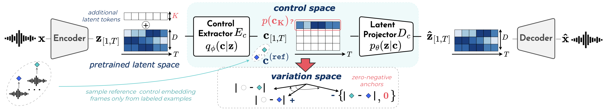

 

<h1>CoALa: A Plugin model for Controlling Audio Latents</h1>
Supporting webpage for ISMIR 2026.
Code is available <a href="https://github.com/nabsara/coala">here</a>.

 

*This webpage will be updated soon with all the qualitative results.*

 

<h3>Abstract</h3>

In recent years, neural audio synthesis has advanced significantly, enabling high-quality real-time waveform generation on standard CPUs. However, defining personalized controls for live musical performance remains challenging, as existing methods typically require large labeled datasets and rely on heavy architectures that are generally impractical for real-time use. In this paper, we propose CoALa, a lightweight plugin model for Controlling Audio Latents in real-time, which enables users to add time-varying musical controls on pretrained neural audio synthesis models using only a limited set of labeled examples. Our method leverages a variational autoencoder with a contrastive learning regularization to disentangle control-relevant features from the pretrained latent space in designated dimensions. We rely on labeled frames as an augmentation strategy to generate multiple views of similar control variations for each unlabeled latent sequence, and apply the contrastive objective on these variation embeddings. By augmenting the pretrained latent space with temporal latent tokens, our method supports an arbitrary number of control variables, generalizes to highly compact latent representations, and can simultaneously disentangle multiple time-varying controls evolving at different temporal scales. Our model defines an invertible mapping between both latent and control trajectories and achieves high control accuracy while preserving synthesis quality for feature extraction, editing, and conditional synthesis tasks, using as little as 10\% labeled data. Its lightweight streamable architecture further enables fast CPU inference, making it well suited for real-time applications in Max/MSP environments.

 
 

<b>Figure 1: </b>Approach overview.

 
 

Here, we provide audio examples and additional results to complete the experiments section from the paper and illustrate the control abilities of our proposed method. We organise the results into 3 parts:
- [Disentangling one control](#disentangling-one-control)
- [Disentangling multiple controls](#disentangling-multiple-controls)
- [Real-time application in MaxMSP](#real-time-application-in-maxmsp)

# Disentangling one control

We demonstrate **CoALa** for disentangling and controlling the **spectral centroid** on the [Music2Latent](https://github.com/SonyCSLParis/music2latent) pretrained model with the *MedleySolosDB* dataset, using only **10% labeled data**.

### Reference and Reconstruction

The examples below compare the original codec output and its reconstruction.

  <video style="width: 50%; min-width: 0;" controls loop playsinline preload="metadata">
    <source src="assets/ex_centroid/ex204_spectrogram_centroid_gt_codec.mp4" type="video/mp4">
  </video>
  
<strong>Ground truth (codec output)</strong>

  <video style="width: 50%; min-width: 0;" controls loop playsinline preload="metadata">
    <source src="assets/ex_centroid/ex204_spectrogram_centroid_reconstruction.mp4" type="video/mp4">
  </video>
  
<strong>Reconstruction</strong>

### Controlling the Spectral Centroid

The following examples demonstrate how CoALa responds to 4 different control trajectories, consisting of combinations of ascending and descending ramps, defined in the control space.

  

    <video style="width: 100%; display: block;" controls playsinline preload="metadata">
      <source src="assets/ex_centroid/ex204_spectrogram_centroid_crescendo-crescendo.mp4" type="video/mp4">
    </video>
    
<strong>Control signal conditining: 2 ascending ramps</strong>

  

  

    <video style="width: 100%; display: block;" controls playsinline preload="metadata">
      <source src="assets/ex_centroid/ex204_spectrogram_centroid_crescendo-decrescendo.mp4" type="video/mp4">
    </video>
    
<strong>Control signal conditining: ascending then descending ramps</strong>

  

  

    <video style="width: 100%; display: block;" controls playsinline preload="metadata">
      <source src="assets/ex_centroid/ex204_spectrogram_centroid_decrescendo-crescendo.mp4" type="video/mp4">
    </video>
    
<strong>Control signal conditining: descending then ascending ramps</strong>

  

  

    <video style="width: 100%; display: block;" controls playsinline preload="metadata">
      <source src="assets/ex_centroid/ex204_spectrogram_centroid_decrescendo-decrescendo.mp4" type="video/mp4">
    </video>
    
<strong>Control signal conditining: 2 descending ramps</strong>

  

# Disentangling multiple controls

[TO COMPLETE]

# Real-time control streaming application in Max/MSP with pretrained RAVE models

Finally, we demonstrate CoALa for real-time, interactive control of pretrained RAVE models within Max/MSP.

### Demo 1: CoALa streaming with 1 control:

CoALa enables real-time control of the spectral centroid in a RAVE model pretrained on the MusDB18HQ-drums dataset. 

The control dimension is learned using 10% labeled data, with spectral centroid annotations automatically extracted from raw audio using [*librosa*](https://librosa.org/).

<video width="700" controls>
  <source src="assets/demos_max/ismir26_demo_max_rave_coala_centroid_drums.mp4" type="video/mp4">
</video>

### Demo 2: CoALa streaming with 3 controls:

CoALa enables real-time control of 3 perceptual features in the pretrained RAVE [percussion](https://acids-ircam.github.io/rave_models_download) model: *Loudness*, *Sharpness* and *Booming*. 

These control dimensions were disentangled simulatneously using 10% labeled data, with labels extrated from raw audio using the [*Audio Commons Timbral Models*](https://github.com/AudioCommons/timbral_models) library.

<video width="700" controls>
  <source src="assets/demos_max/ismir26_demo_max_rave_coala_percu_loud_sharp_boom.mp4" type="video/mp4">
</video>

